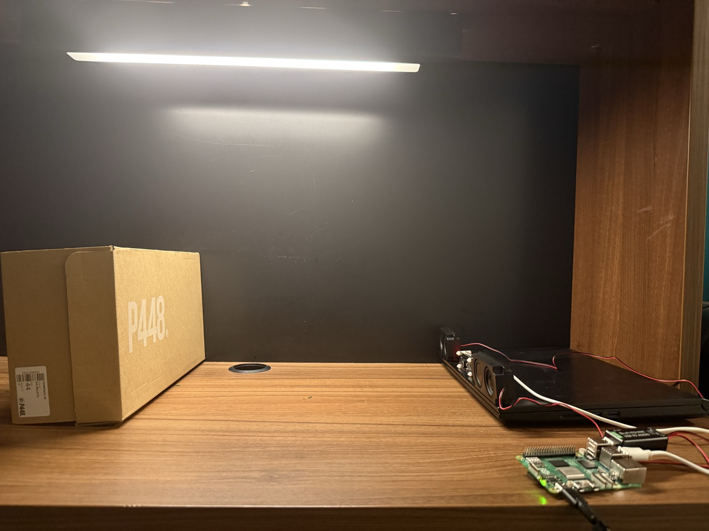
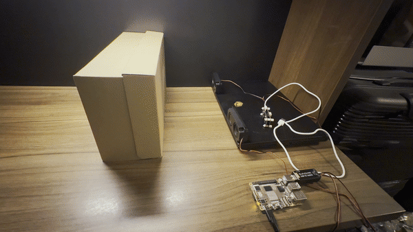
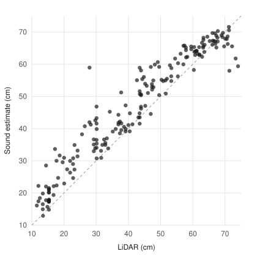

# EchoDesk

EchoDesk tells how far an object on a desk is, between 10 and 75 cm, using only a speaker and a microphone on a Raspberry Pi. It plays a short chirp, listens to the echo and compares it with echoes it has heard before at known distances.

Those known distances come from a LiDAR, not a tape measure. While training, a DFRobot SEN0682 sits next to the speaker and labels every recording. After training I unplug it, and the distance comes from sound alone.





## How it works

Each reading is three 3 ms chirps (2 to 12 kHz) at 48 kHz. Every recording is correlated with the chirp, lined up on its strongest peak, and the 0.25 to 12 ms after that peak becomes a 256-point echo profile. The three profiles are averaged.

To guess a distance, the program subtracts a recording of the empty desk, normalises, and looks for the k most similar profiles from training (k-nearest neighbours). k is picked from 1, 3, 5 and 9 on a validation run.

The labels come from the middle of the LiDAR's 64×8 grid: four points on line 4, straight ahead. The label is the median of their Z distance. The LiDAR is read three times before the chirps and three times after. If the two readings differ by more than 2 cm the target moved, and the sample is thrown away.

The range starts at 10 cm because the SEN0682 doesn't measure anything closer.

## Results

4 runs, 907 samples kept, 808 skipped because the target moved. Test run: run04 (188 samples), k = 9.
| | cm |
|---|---:|
| Mean error, sound vs LiDAR | 5.22 |
| RMSE | 6.86 |
| 90% of samples within | 11.83 |
| Worst sample | 31.02 |
| Always guessing the median | 16.83 |
| LiDAR spread within a sample (median) | 1.74 |
Distance display enabled.




Each dot is one reading from the last run, which the model never saw during training. The dashed line is where sound and LiDAR agree exactly.

These errors are measured against the LiDAR, not against the true distance. DFRobot rates the SEN0682 at ±4 cm on a white board and ±10 cm on a cardboard box. So this shows how well sound alone can reproduce the LiDAR. The LiDAR spread row is how much the LiDAR itself jumped around while one sample was taken.

It's trained on one target in one spot on one desk. A different object or a moved speaker needs new runs. With nothing in front of it, it still shows a distance.

## Hardware

- Raspberry Pi 5
- USB audio board with a small speaker and microphone
- DFRobot SEN0682 64×8 ToF LiDAR (training only)
- A flat target: a box with a sheet of white paper on the side facing the sensor

The LiDAR plugs into the Pi with its USB-C cable. `echo_desk.py` finds it as `/dev/ttyUSB0` or `/dev/ttyACM0` by itself.

It also works on the GPIO serial pins: 5V to pin 2, GND to pin 6, TX to pin 10 and RX to pin 8. On a Pi 5 that needs `dtoverlay=uart0-pi5` in `/boot/firmware/config.txt` and `--port /dev/ttyAMA0`.

## Setup

```sh
sudo apt install -y python3-venv libportaudio2 alsa-utils
python3 -m venv .venv
source .venv/bin/activate
python -m pip install -r requirements.txt
```

## Training with the LiDAR

```sh
python echo_desk.py devices
python echo_desk.py configure --input 0 --output 0 --amplitude 0.12
python echo_desk.py check
python echo_desk.py lidar
python echo_desk.py baseline
python echo_desk.py collect
python echo_desk.py train
```

`devices` lists the audio devices; use its numbers in `configure`. `lidar` prints what the sensor sees, for aiming. `baseline` records the empty desk.

`collect` records one run while the web page shows the LiDAR reading and how many samples each centimetre has. Move the target a step, let go, wait for the next reading, repeat from 10 to 75 cm, then Ctrl+C. Do at least three runs. `train` uses the last run as the test, the one before it for picking k, and learns from the rest. It writes `model.npz`, `report.json` and `media/test.svg`, and refuses to overwrite an existing model.

## Sound only

Unplug the LiDAR's USB cable, then:

```sh
python echo_desk.py live
```

`live` doesn't use the LiDAR at all. The page is served on the Pi's localhost, so from a laptop:

```sh
ssh -N -L 8000:127.0.0.1:8000 echoeye@echoeye.local
```

and open `http://localhost:8000`.

## Tests

```sh
python -m unittest -v
```

These need no hardware. They use synthetic echoes and a fake LiDAR that answers like the real one.

## Files

- `echo_desk.py`: audio, LiDAR, training, the web server and the command line
- `index.html`: the web page
- `test_echo_desk.py`: tests
- `data/`: the empty-desk recording and one file per run
- `model.npz`, `report.json`, `config.json`: the trained model, its test numbers and the audio settings
- `media/`: the pictures in this README

The LiDAR protocol follows DFRobot's [DFRobot_64x8DTOF](https://github.com/DFRobot/DFRobot_64x8DTOF) library.
